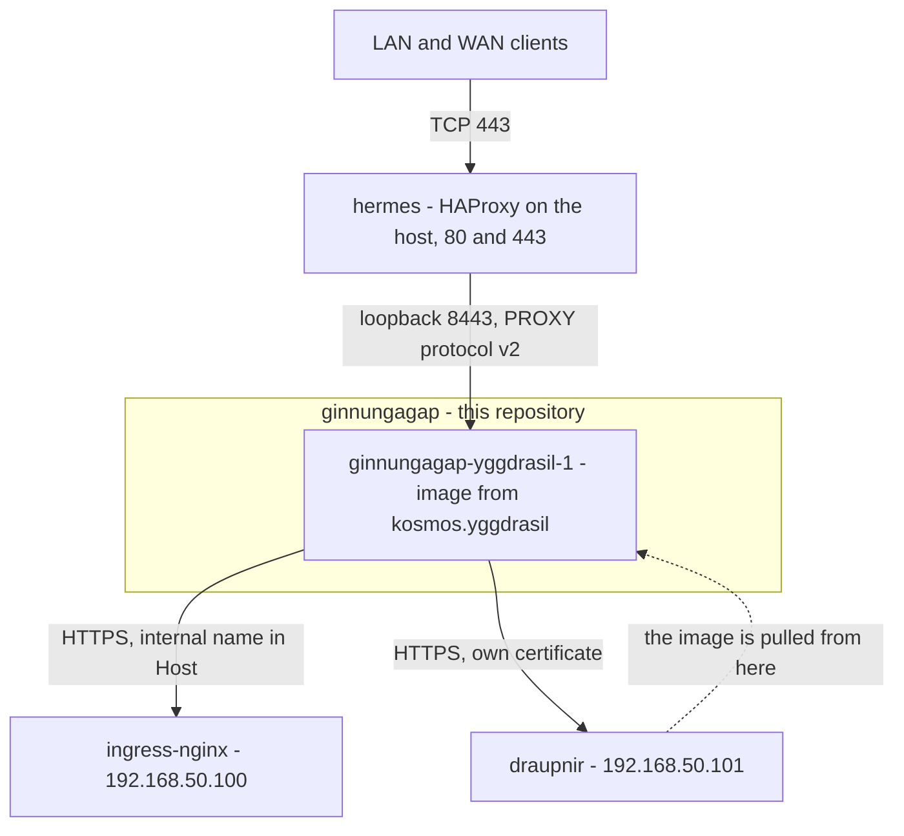

# ginnungagap

The Compose project that holds what runs directly in Docker Desktop on Kosmos.

Today it holds one service, `yggdrasil`, the application edge. It exists as a named grouping rather than a bare `docker run` so that whatever comes next joins something that already has a name, a network, a deploy path and a startup path, instead of acquiring its own.

`ginnungagap` is a Norse name because it groups containers, and deliberately not a realm name, because those are reserved for Kubernetes namespaces. The reasoning is in [Conventions](../kosmos.bootstrap/docs/Conventions.md), and what every other name used here refers to is in [Component Inventory](../kosmos.bootstrap/docs/Inventory.md).

## Where it sits



The dotted edge is the only surprising one: the edge's own image comes from a registry that the edge fronts externally. That is not circular, and why is covered in [Bootstrapping yggdrasil](#bootstrapping-yggdrasil).

## Responsibilities

| Does                                                        | Does not                                                                            |
| ----------------------------------------------------------- | ----------------------------------------------------------------------------------- |
| declare how `yggdrasil` is run: mounts, port, privileges    | build the image or hold its configuration, which is [kosmos.yggdrasil](../kosmos.yggdrasil) |
| pin the exact image version deployed, with history          | decide what the image contains                                                      |
| name the project and its network                            | appear in any DNS name, because it names a grouping                                 |
| get copied to Kosmos by `deploy.command`                    | bring itself up at login, which `atlas` does                                        |
| hold the only writable mount the edge has                   | hold state of its own; there are no named volumes                                   |

## Layout

```
compose.yaml      the project: one service, one network
.env              the pinned image reference, tracked
deploy.command    copies both to Kosmos
```

Those three are the project. `compose.yaml` carries its reasoning inline rather than repeating it here, so that the reason for a setting sits next to the setting.

## The decisions worth knowing

| Choice                                            | Reason                                                                                                          |
| ------------------------------------------------- | --------------------------------------------------------------------------------------------------------------- |
| `pull_policy: missing`                            | makes first bootstrap and steady state the same file, with no first-run branch                                  |
| immutable git SHA tags, never `latest`            | rollback is one line, and it is what makes `pull_policy: missing` safe                                           |
| `.env` tracked rather than ignored                | the pinned tag is the deployment record and wants version history                                                |
| published to `127.0.0.1` only                     | the listener trusts a PROXY header from any source, which is only safe if nothing off-host can open the connection |
| `read_only`, `cap_drop: ALL`, `no-new-privileges` | nothing writes outside the log mount and `/tmp`, so the container has no route to more than it started with     |
| `tmpfs` on `/tmp`, in long form                   | the image relocates the pid file and all five temp paths there so the root can be read only, and the size matters |
| `stop_signal: SIGQUIT`                            | nginx's graceful shutdown. The default `SIGTERM` is its fast one and drops connections mid-deploy, which clients see |
| network named `ginnungagap`                       | with one network, the project and the network are the same boundary                                              |
| `restart: unless-stopped`                         | a Docker Desktop restart or a reboot recovers the edge without waiting for `atlas`                              |
| certificates mounted, never copied in             | a private key in an image is a private key in the registry and in every layer cache that pulled it              |

## Bootstrapping yggdrasil

There is an apparent ordering problem. The edge runs an image from `draupnir`, `draupnir` is filled by `brokk`, and `brokk` is reached from outside through the edge. Each looks like it needs one of the others first.

It is resolved rather than engineered around, in two parts.

**The first image is built by hand on Kosmos and pushed**, which is "The first push" in the [registry document](../kosmos.bootstrap/docs/kubernetes/applications/01_DockerRegistrySetup.md). That breaks the dependency on `brokk` existing.

**The image is therefore already in the local image store**, because the build happened here and the build command already tags it with the registry prefix. So the very first `docker compose up` resolves the reference locally and never contacts `draupnir` at all. Once `brokk` is building instead, the same `pull_policy: missing` pulls it, because then it is genuinely absent.

That is why there is no bootstrap mode, no conditional, and no registry credentials needed on the first run.

The in-cluster pull path is unaffected by any of this. `containerd` reaches `draupnir` directly across the private VM subnet, so the cluster keeps pulling images while the edge is down. That is what makes hosting the edge's own image in a registry the edge fronts safe rather than circular.

> **The host reaches `draupnir` by name only because of an `/etc/hosts` entry.** The Docker Desktop daemon does not read the host's `/etc/resolver` files, so it never sees Orpheus and cannot resolve `kosmos.internal` on its own. The entry is made during setup and recorded in the registry document. Without it, `docker pull` fails with `lookup draupnir.hades.kosmos.internal ... no such host`, which names a symptom rather than the cause.

## Runtime prerequisites

The container fails clearly rather than mysteriously when one of these is missing, but it does fail.

| Requirement                                                                  | Why                                                                                            |
| ---------------------------------------------------------------------------- | ---------------------------------------------------------------------------------------------- |
| Docker Desktop running                                                       | there is no daemon otherwise, and it is a GUI application that has to be set to start at login  |
| `/Users/typhon/certs/canunu.me/canunu.me.fullchain.pem` and its `.key`       | mounted as files. A missing source becomes a directory, and nginx then reports an unreadable certificate rather than an absent one |
| `/Users/typhon/certs/kosmos-local-ca/kosmos-local-ca.crt`                    | the authority that internal upstreams are verified against                                     |
| `/Users/typhon/var/logs/kosmos/yggdrasil` exists and is writable by uid 101   | the entrypoint checks both and exits with an explanation. The most likely first run failure     |
| `YGGDRASIL_IMAGE` set in `.env`                                              | Compose refuses to start, with an explanation, while it is empty                               |
| the image present locally or pullable                                        | see [Bootstrapping yggdrasil](#bootstrapping-yggdrasil)                                        |
| `hermes` running                                                             | not needed to start, but nothing reaches the edge without it, since 8443 is loopback only      |

## Bringing it up

On Kosmos, from the deployed directory:

1. `cd ~/ginnungagap`
2. `docker compose up -d`
3. `docker compose ps`

Expected result:

- one container, `ginnungagap-yggdrasil-1`, `running` and shortly afterwards `healthy`
- `docker network ls` lists `ginnungagap`

The health status comes from the image's own check against its container-local status listener, so `healthy` proves nginx is answering rather than merely that the process started.

## Deploying a new version

1. Build and push the new image, or let `brokk` do it
2. Set the new reference in `.env`
3. Commit, so the deployment record moves with the change
4. `./deploy.command`
5. On Kosmos: `docker compose up -d`

Compose recreates the container because the image reference changed, and does nothing if it did not. Rolling back is the same sequence with the previous value.

The public certificate rotates independently of all of this. Replacing the two files on the host and restarting the container is the whole procedure: nothing is rebuilt and no image reference changes.

## Verification

1. `docker compose config` renders the project with the image reference resolved
2. `curl --haproxy-protocol -sI --resolve canunu.me:8443:127.0.0.1 https://canunu.me:8443/ping` reaches the edge directly
3. `curl -sI https://canunu.me/ping` reaches it through `hermes`
4. `ls -l /Users/typhon/var/logs/kosmos/yggdrasil/` shows `yggdrasil.error.log` and a dated access log

The PROXY protocol flag in step 2 is not optional. Once the listener requires the header, a plain `curl` against the published port cannot complete a request, so its failure would mean nothing.

## Not covered here

- how the image is built, configured or tested: [kosmos.yggdrasil](../kosmos.yggdrasil)
- what the names mean and why: [Conventions](../kosmos.bootstrap/docs/Conventions.md)
- installing Docker Desktop and Compose, the `/etc/hosts` entry, and the first push: the Kosmos setup documents in [kosmos.bootstrap](../kosmos.bootstrap)
- bringing this up at login: `atlas`, in [kosmos.bootstrap](../kosmos.bootstrap)
